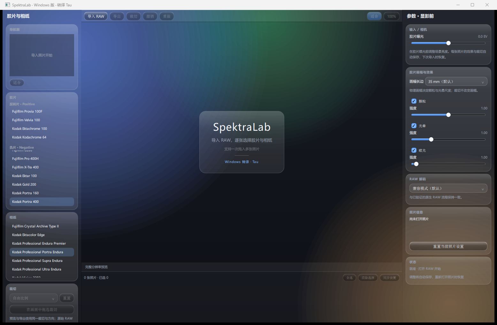
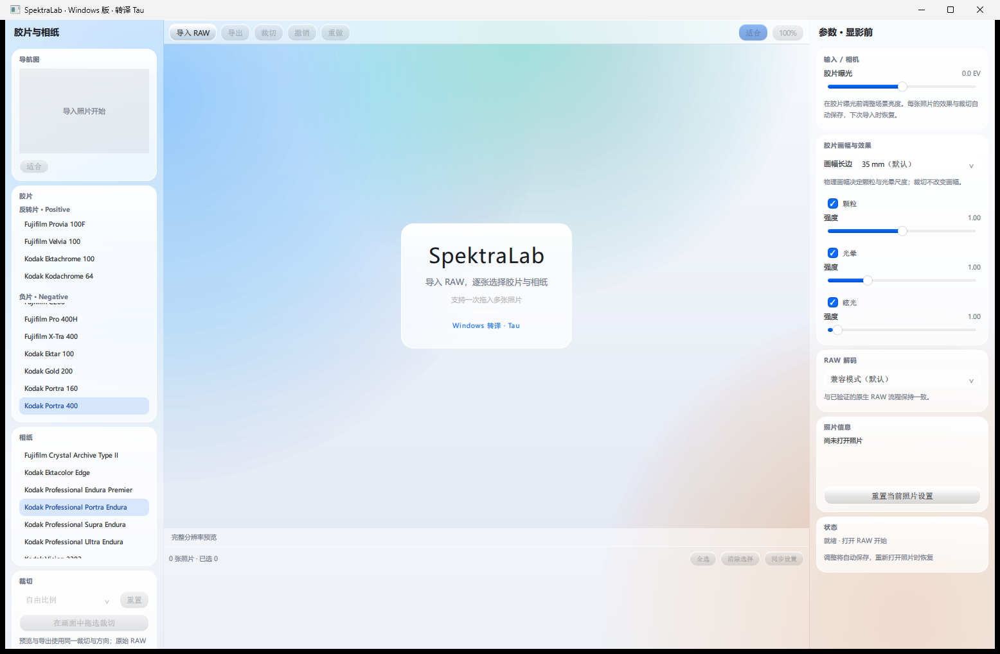
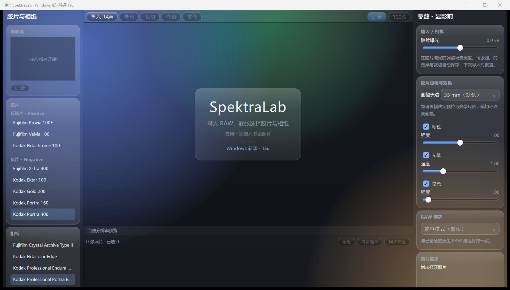

# SpektraLab-Win

> macOS 胶片与相纸模拟器 **SpektraLab** 的 Windows 移植版，界面按 Apple 液态玻璃（Liquid Glass）视觉语言重制。

<p align="center">
  
</p>

<p align="center">
  
  
</p>

---

## 这是什么

[SpektraLab](https://github.com/JamesQiu2005/SpektraLab) 是一个用 **81 个波长做光谱计算**的胶片模拟器——不是 LUT 滤镜，而是把光真正穿过胶片与相纸的染料层，像暗房一样算出一张相片。

上游是 macOS 产品（SwiftUI + Metal）。本项目把它的 **Windows 侧（Qt Quick + Vulkan）完整构建出来**，并把界面按 Apple 2025 的液态玻璃语言重做。

**引擎、色彩管线、RAW 解码、导出路径全部是上游实现，一行未改。**
本项目只做三件事：Windows 构建、界面重制、暴露 MCP/CLI 给自动化调用。

---

## 特性

### 渲染

- **光谱计算**：81 个波长穿过胶片与相纸的染料层，物理单位建模
- **28 款实测配置**：Kodak、Fujifilm、Agfa 等胶片与相纸，另有 8 款相纸 LUT
- **物理尺度**：指定底片是 135 还是 120，颗粒、光晕、成色剂扩散按微米缩放
- **Vulkan compute**：34 个计算 kernel 在 GPU 上跑，实测 33MP 首帧约 0.87 s

### 界面

- **液态玻璃**：半透明玻璃面板、折射高光边、大圆角、柔和彩色光晕背景
- **深色 / 浅色**：一键切换，全界面同步换色，设置持久化
- **字体 85%–140%**：字号、控件内边距、列表行高一起缩放
- **全中文**

### 自动化

- **MCP 接口**：8 个工具，任何支持 MCP 的 AI agent 都能驱动
- **CLI**：`spk_raw_render.exe` 做 RAW → TIFF16 批处理
- **单文件免安装**：一个 exe 双击即用

---

## 下载

到 [Releases](../../releases) 下载，三种形态任选：

| 文件 | 大小 | 说明 |
|---|---|---|
| `SpektraLab.exe` | ~34 MB | **单文件免安装**。双击即用，首次运行释放运行时到本地缓存，之后秒开 |
| `SpektraLab-Windows-x64-portable.zip` | ~48 MB | 便携包，解压后运行 `SpektraLabQt.exe` |
| `SpektraLab-Windows-x64-setup.exe` | ~34 MB | 安装包，带卸载器 |

### 系统要求

| 项目 | 要求 |
|---|---|
| 系统 | Windows 10 64 位 1809+（实测于 Windows 11 24H2 build 26100） |
| 显卡 | 支持 **Vulkan 1.0+**，具备 compute 队列 |
| 磁盘 | 单文件版约 112 MB（解压后）；便携版约 112 MB |
| 运行时 | 不需要 Qt、Python、.NET |

> 首次启动若画布空白或提示无法创建设备，请先更新显卡驱动。

---

## 快速开始

1. 运行 `SpektraLab.exe`（或解压便携包后运行 `SpektraLabQt.exe`）
2. 点左上角 **导入 RAW**（Ctrl+O），可一次选多张
3. 左侧选胶片与相纸，右侧调曝光、画幅、颗粒、光晕、眩光
4. Ctrl+E 导出：TIFF16 / PNG8 / PNG16 / JPEG8

编辑会按照片自动保存，**RAW 文件与所在目录不会被修改**。

### 界面说明

| 区域 | 内容 |
|---|---|
| 左栏 | 导航图、胶片、相纸、裁切、放大机 |
| 中间 | 画布（滚轮缩放，拖动平移，Ctrl+0 适合，Ctrl+1 物理 100%） |
| 右栏 | 参数、RAW 解码、照片信息、状态、**外观**、**关于** |
| 底部 | 胶片条，可多选与同步设置 |

「外观」在右栏底部：配色模式切换、字体大小滑块、恢复默认。

---

## MCP 接口

让 AI agent 驱动 SpektraLab。客户端配置：

```json
{
  "mcpServers": {
    "spektralab": {
      "command": "<安装目录>\\spektralab-mcp.exe"
    }
  }
}
```

提供 8 个工具：

| 工具 | 作用 |
|---|---|
| `get_schema` | 全部参数名、类型、取值范围 |
| `list_stocks` | 20 款胶片 + 8 款相纸 |
| `describe_image` | RAW 元信息 |
| `get_edit` | 读取照片参数 |
| `edit_image` | 合并参数并保存 |
| `reset_edit` | 清除参数 |
| `process_image` | 渲染导出 TIFF16 |
| `export_image` | 同上，可临时覆盖参数 |

详见 [docs/MCP.md](docs/MCP.md)。

---

## 命令行

```bat
spk_raw_render.exe --input photo.arw --output out.tif ^
                   --report out.json --resources resources ^
                   [--params edit.json] ^
                   [--decode-mode compatible16|headroom]
```

- 输出 sRGB 16 位 TIFF，**不覆盖已有文件**
- `--params` 传一组参数覆盖（字段名见 `get_schema`）
- `headroom` 模式保留部分高光，但仍是整数去马赛克

---

## 与上游的关系

| | |
|---|---|
| 上游 | [JamesQiu2005/SpektraLab](https://github.com/JamesQiu2005/SpektraLab) |
| 基线提交 | `267ee24380091e5bee87658d00f6c33d77321194` |
| 上游原型 | [andreavolpato/spektrafilm](https://github.com/andreavolpato/spektrafilm)（胶片模型与实测配置） |

上游本身是四端共构：`modern_UI/` 是 macOS SwiftUI，`windows_UI/` 是 Qt Quick，`engine/` 是 C++20 引擎（Metal + Vulkan 双后端），`desktop/` 是 Tauri。

本项目构建的是 **`windows_UI` + `engine`** 这条路线。

### 对上游源码的修改

只改了 3 处，都是 Windows 移植缺陷，不涉及算法：

| 文件 | 改动 | 原因 |
|---|---|---|
| `engine/src/io/image_writer.cpp` | `dwShareMode` 加 `FILE_SHARE_DELETE`；回滚删除加有界重试 | Windows 要求共享模式含该标志才能设删除标记，否则导出失败无法清理半成品；24H2 上首次删除标记请求必返 `ERROR_ACCESS_DENIED` |
| `engine/tests/image_writer_test.cpp` | 同一断言的测试侧对齐 | 同上 |
| `windows_UI/CMakeLists.txt` | `LANGUAGES CXX` → `LANGUAGES C CXX` | 引擎要编译 `volk.c`，缺 C 语言独立配置会失败 |

补丁在 [patches/](patches/)。界面改造集中在 `windows_UI/qml/`，逻辑未动。

详见 [UPSTREAM.md](UPSTREAM.md)。

---

## 构建

需要 MinGW GCC 13.1+、CMake 3.25+、Vulkan headers、glslang、LibRaw 0.22.2、Qt 6.11.3 MinGW SDK。

```bat
cmake -S windows_UI -B build/qt -G "MinGW Makefiles" ^
  -DCMAKE_BUILD_TYPE=Release ^
  -DCMAKE_C_COMPILER=<mingw>/gcc.exe ^
  -DCMAKE_CXX_COMPILER=<mingw>/g++.exe ^
  -DCMAKE_PREFIX_PATH=<qt>/mingw_64 ^
  -DSPEKTRALAB_SOURCE_ROOT=<source> ^
  -DBUILD_TESTING=ON -DSPEKTRALAB_REQUIRE_VULKAN=ON ^
  -DSPEKTRALAB_VULKAN_INCLUDE_DIR=<vulkan>/include ^
  -DSPEKTRALAB_GLSLANG=<glslang>/glslang.exe ^
  -DSPEKTRALAB_LIBRAW_SOURCE=<libraw>
cmake --build build/qt --parallel 8
<qt>/bin/windeployqt.exe --release --compiler-runtime ^
  --qmldir <source>/windows_UI/qml build/qt/app/SpektraLabQt.exe
```

> **构建路径必须是纯 ASCII。** 实测含中文的路径会让 CMake 按 GBK 误解 UTF-8，
> 链接器找不到自己的运行库；`subst` 盘符、目录 junction、Ninja 生成器都无效。
> 但**产物在中文路径下运行正常**。

完整步骤与踩坑见 [docs/BUILD.md](docs/BUILD.md)。

---

## 已知限制

以下 macOS 功能**未移植**，界面中不会出现：

- 片边（Film Edge）、日期后背（Date Back）、半格拼接
- Cineon DI、场景宽容度映射、对比蒙版
- EDR / HDR、广色域显示、色彩软打样

另外：

- Nikon HE / HE\* 压缩 RAW 不受支持，会明确拒绝打开
- MCP 的 `measure_latitude` / `place_scene` 依赖上述未移植能力，暂缺
- 安装包与 exe 均未做代码签名，SmartScreen 会提示

---

## 许可证

| 组件 | 许可证 |
|---|---|
| 应用与引擎 | **GPL-3.0-or-later** |
| 胶片与相纸配置、放大 LUT | **CC BY-SA 4.0**（Andrea Volpato / spektrafilm） |
| Qt 6.11.3 | LGPL-3.0 / GPL 等 |
| LibRaw 0.22.2 | LGPL-2.1 或 CDDL-1.0 |

完整许可证文本随发行包附在 `licenses/` 目录。

本项目遵循 GPL-3.0：对应源码即本仓库（上游提交 + `patches/` 里的 3 个补丁）。

---

## 致谢

- **James Qiu** — [SpektraLab](https://github.com/JamesQiu2005/SpektraLab) 原作者，本项目的全部渲染能力来自这里
- **Andrea Volpato** — [spektrafilm](https://github.com/andreavolpato/spektrafilm) 的胶片过程模型与 28 款实测配置
- **Qt Project** — Qt 6.11.3
- **LibRaw** — RAW 解码

---

## 作者

Windows 移植与界面重制：**Tau**
